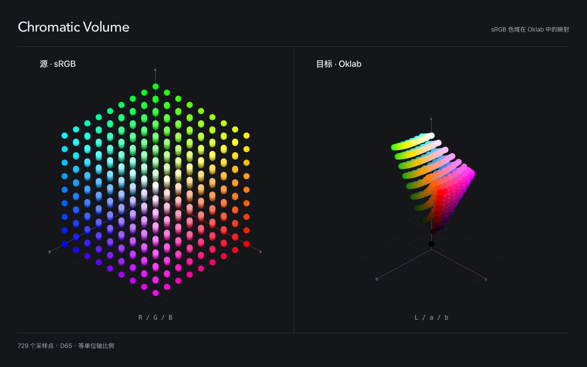
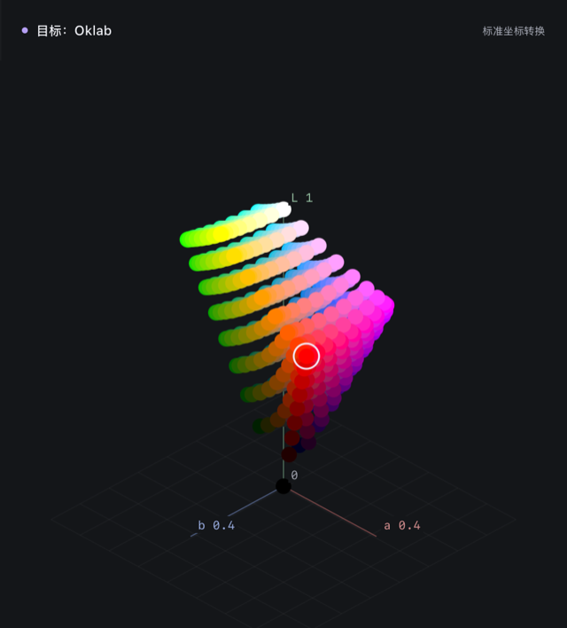
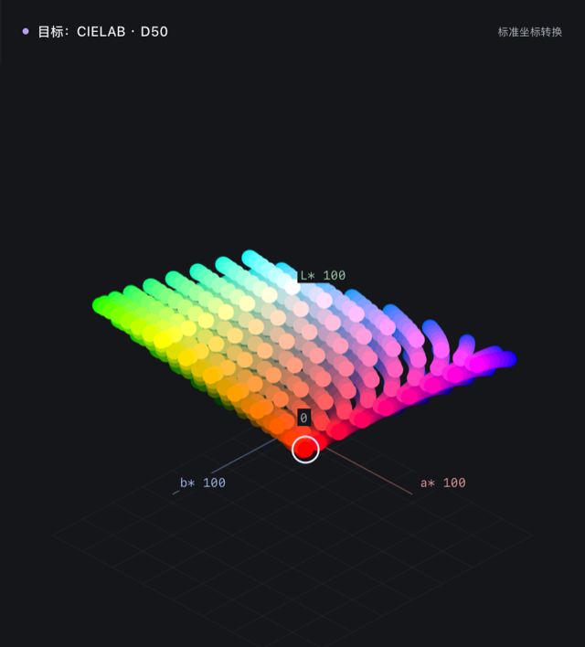
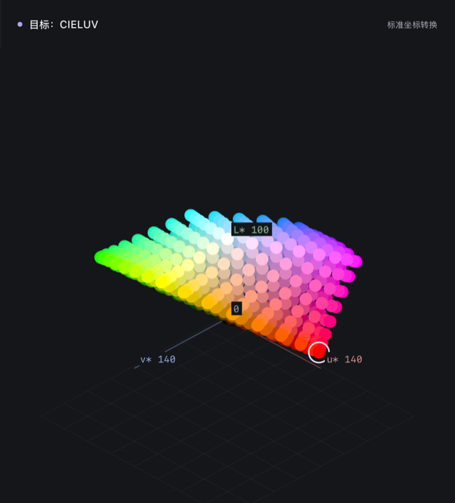
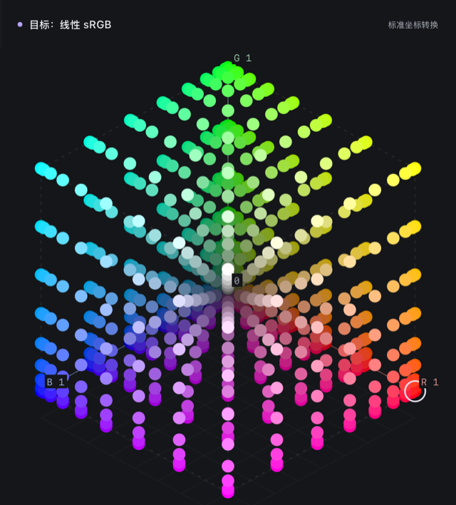
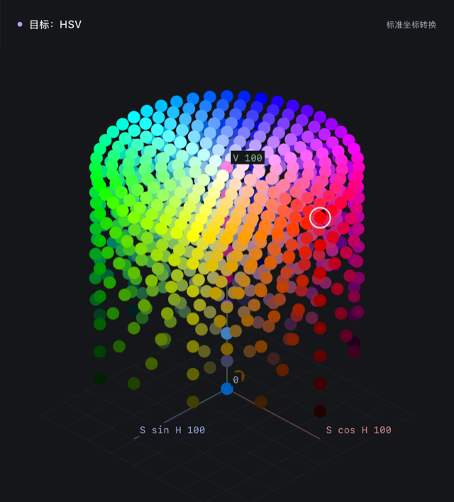
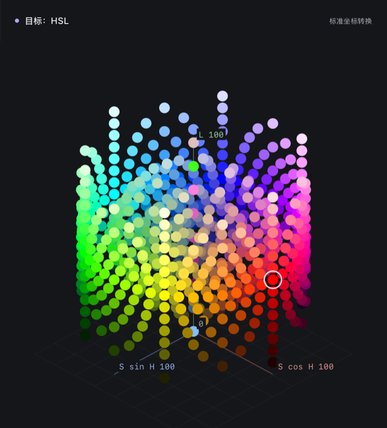
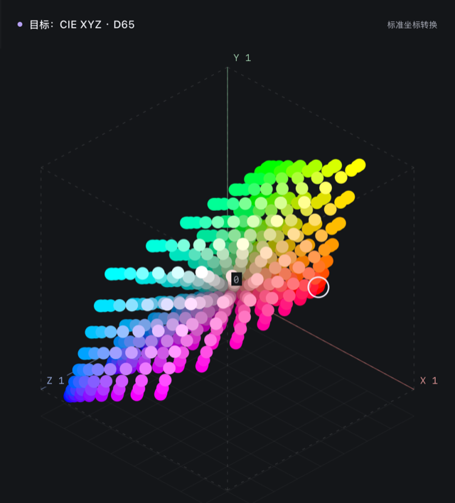
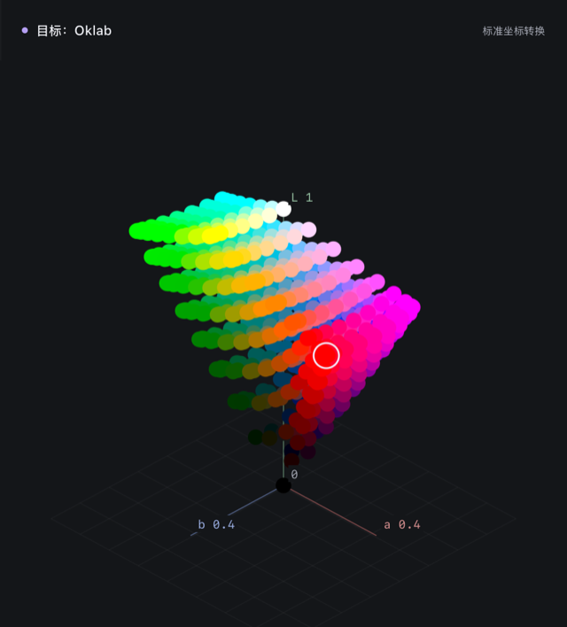
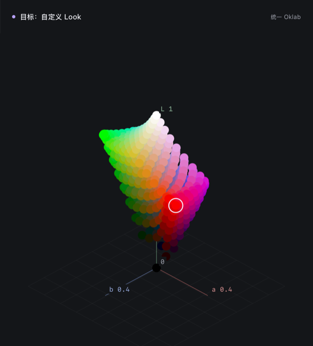

# Chromatic Volume

**把颜色空间画成可以旋转的三维体积**

同一组 729 个 sRGB 样本：左边是 RGB 立方体，右边是它在 Oklab 中的真实形状

 

## 🖼️ 图例

每张图都是工作台的实际渲染：同一组源样本放进不同模型，直接看形状怎么变。

<table>
  <tr>
    <td width="33%"></td>
    <td width="33%"></td>
    <td width="33%"></td>
  </tr>
  <tr>
    <td><b>Oklab</b> 立方体被扭成斜置的块：黄色角位于高亮度，蓝色角沉到低亮度</td>
    <td><b>CIELAB · D50</b> 同为对立色坐标，与 Oklab 并排可看出两者对蓝紫区域的处理差异</td>
    <td><b>CIELUV</b> u*v* 平面更宽更扁，红色角明显外凸</td>
  </tr>
  <tr>
    <td></td>
    <td></td>
    <td></td>
  </tr>
  <tr>
    <td><b>线性 sRGB</b> 去掉传递函数后，均匀编码的样本向暗部聚拢</td>
    <td><b>HSV</b> 色相绕轴旋转，饱和度沿半径展开，明度向上</td>
    <td><b>HSL</b> 纯色停在中间亮度，黑白分别收向两端</td>
  </tr>
  <tr>
    <td></td>
    <td></td>
    <td></td>
  </tr>
  <tr>
    <td><b>Display P3 → CIE XYZ</b> 线性三刺激值中，RGB 立方体变成一个斜切的平行六面体</td>
    <td><b>Rec.2020 → Oklab</b> 更宽的色域把体积推向 a / b 轴外侧</td>
    <td><b>自定义 Look</b> 叠加饱和度、串扰、高光褪色等阶段后，色体积被压扁并剪切</td>
  </tr>
</table>

屏幕只能显示 sRGB 范围内的颜色，宽色域的点在着色时会被裁剪；点的位置不受影响。

 

## ✨ 工作台功能

| 功能            | 说明                                                                                                                                          |
| --------------- | --------------------------------------------------------------------------------------------------------------------------------------------- |
| **源色域**      | sRGB、线性 sRGB、Display P3、Rec.2020、Adobe RGB、ProPhoto RGB、ACEScg、ACEScc、Rec.709 OETF、Rec.709 + BT.1886                               |
| **目标模型**    | 21 种：Oklab / OKLCH、CIELAB / LCh、CIELUV / LChuv、CIE XYZ、各 RGB 工作空间、HSL、HSV                                                        |
| **3D LUT**      | 导入 2³–65³ 的 `.cube` 文件，完整加载不降采样；三线性 / 四面体插值；内置 ARRI、Sony、Canon、Panasonic、RED、Blackmagic、Nikon、DJI 摄影机预设 |
| **自定义 Look** | 十种可开关、可调整顺序的处理阶段，观察每一步怎样拉伸、剪切、压扁色体积                                                                        |
| **映射进度**    | 在源位置与目标位置之间插值，看每个点的移动轨迹                                                                                                |
| **精确读数**    | 点击任一点查看各阶段坐标；状态栏报告颜色损失与超出显示范围的点数                                                                              |
| **交互**        | 拖动 / 方向键旋转，两侧同步；滚轮 / `+` `-` 缩放；`Home` 复位；可选自动旋转                                                                   |
| **导出与分享**  | 两侧画布导出为 PNG；完整状态编码进 URL                                                                                                        |
| **自动预览**    | `/preview` 固定展示 sRGB → Oklab 缓慢旋转，可直接嵌入                                                                                         |

 

## 🛠️ 技术实现

- **渲染**：Canvas 2D 正交投影真实三维坐标，按深度排序由远及近绘制，无 WebGL 依赖；按需重绘，预览页限制 24 fps，不可见时暂停。
- **色彩引擎**：[Color.js](https://colorjs.io/) 负责标准转换；BT.709 / BT.1886、ACEScc 与八家摄影机 Log 曲线由项目实现并注册为 Color.js 空间。
- **严格比例**：每个模型只做统一缩放与平移，三轴单位一致；圆柱模型先还原为笛卡尔坐标。LUT 与自定义 Look 两侧共用同一绘图空间、轴和相机。
- **数值验证**：用独立的 Python [Colour Science](https://www.colour-science.org/) 生成参考值，与生产代码交叉比对 5,905 个案例。详见 [色彩科学与验证说明](docs/COLOR-SCIENCE.md)。
- **构建**：TypeScript + Vite，输出纯静态站点；Vitest 单元测试，Playwright headless WebKit 端到端测试。

 

## 📄 许可证

本项目基于 [GNU Affero General Public License v3.0](LICENSE) 开源。
