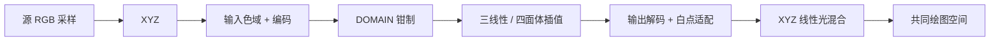

<div align="center">

# Chromatic Volume

**三维色体积工作台 · 在同一组采样上对比 RGB 色域与目标颜色模型**


</div>

<br />

## ✨ 功能说明

### 🎨 色体积对比

选择源 RGB 空间并采样其色域，左右两侧用**同一组样本**分别绘制原始 RGB 坐标与目标模型坐标。默认 **sRGB → Oklab**。

| 类别          | 内容                                                                                                                                                                                                                  |
| ------------- | --------------------------------------------------------------------------------------------------------------------------------------------------------------------------------------------------------------------- |
| **10 种源**   | sRGB · 线性 sRGB · Display P3 · Rec.2020 · Adobe RGB · ProPhoto RGB · ACEScg · ACEScc · Rec.709 OETF · Rec.709 + BT.1886                                                                                              |
| **21 种目标** | Oklab · OKLCH · CIELAB D50/D65 · CIELCh D50 · CIELUV · LChuv · CIE XYZ D50/D65 · sRGB · 线性 sRGB · Display P3 · Rec.2020 · Adobe RGB · ProPhoto RGB · ACEScg · ACEScc · HSL · HSV · Rec.709 OETF · Rec.709 + BT.1886 |
| **采样密度**  | 5³ / 9³ / 13³，默认 729 点                                                                                                                                                                                            |

- **严格等比例**：笛卡尔坐标各轴保持相同单位，并显示数值轴端标记；也可切换为示意比例。
- **映射进度**：在源位置与目标位置之间插值，观察每个点的移动轨迹。
- **精确读数**：点击点阵或输入编号选中样本，右侧列出参考白、转换路径、绘图比例和各阶段坐标；无彩色样本的色相显示为「未定义」。原生与共同视图均使用对应模型的数值轴。
- **越界提示**：分别报告目标转换造成的颜色损失与超出 sRGB 显示范围的点数。目标编码自身的负值／上限限制可能不可逆；点位和输出色样使用目标坐标实际解码后的颜色。

### 🎞️ 3D LUT 导入

导入 `.cube` 文件，在工作台中观察一个具体的 RGB → RGB 响应如何改变色体积。

- 支持 **2³–65³** 尺寸、`DOMAIN_MIN/MAX`、最大 32 MB；33³（35,937 节点）与 65³（274,625 节点）**完整加载，不降采样**。
- **三线性 / 四面体**插值可选，默认四面体。
- 输入、输出两端分别指定**色域**与**传递函数**，配置完整后才计算，不按文件名猜测。
- 状态栏统计 DOMAIN 钳制点数；读数同时列出源坐标、LUT 输入（钳制前）与 LUT 原始输出。
- BT.1886 两端可独立设置黑位 0–10、白位 20–1000 cd/m²。
- 文件只在浏览器本地解析，不上传、不持久化。

**内置摄影机预设**（选中后同步设置色域与 Log 曲线）：

| 厂商       | 色域 / 编码                                |
| ---------- | ------------------------------------------ |
| ARRI       | AWG3 / LogC3 · AWG4 / LogC4                |
| Sony       | S-Gamut3 / S-Log3 · S-Gamut3.Cine / S-Log3 |
| Canon      | Cinema Gamut / Canon Log 2 · Canon Log 3   |
| Panasonic  | V-Gamut / V-Log                            |
| RED        | REDWideGamutRGB / Log3G10                  |
| Blackmagic | Blackmagic Wide Gamut / Film Gen 5         |
| Nikon      | N-Gamut / N-Log                            |
| DJI        | D-Gamut / D-Log                            |

### 🎛️ 自定义处理阶段

十种可开关、可调整顺序的教学变换，基于线性对立色坐标，直观展示每一步对色体积的几何影响：

> 色彩饱和度 · 色彩串扰 · 高光褪色 · 鲜亮度降低 · 对比增强 · 中性色偏 · 区域亮度 · 区域饱和度 · 区域色相偏移 · 区域色相聚拢

处理阶段与 LUT 均使用共同绘图空间；「处理强度」为 0 时恢复源色并使两侧点位重合。「保留输入色」可在变形后继续追踪每个样本。

### 🖱️ 交互

| 操作     | 方式                                                           |
| -------- | -------------------------------------------------------------- |
| 旋转     | 鼠标 / 触摸拖动任一画布，两侧同步；或方向键                    |
| 缩放     | 聚焦画布后滚轮，`+` / `-`，或缩放滑块                          |
| 复位     | `Home` 或视角按钮                                              |
| 自动旋转 | 可选开启；页面隐藏或系统「减少动态效果」时自动停止             |
| 导出     | 将两侧画布、源／目标、实际绘图空间、轴比例和着色状态导出为 PNG |
| 分享     | 完整工作台状态编码进 URL，打开链接即可恢复                     |

另提供 `/preview` 自动演示页：固定展示 sRGB → Oklab 缓慢旋转，可直接嵌入展示。

<br />

## 🛠️ 技术实现

### 色彩管理链路

所有标准转换都使用源空间自身的基色、传递函数与白点；LUT 模式下的完整处理链如下：



- **线性光混合**：处理强度在 XYZ 中混合，避免在两组不相关的编码三元组之间插值。
- **共同绘图空间**：LUT 与自定义处理两侧共用 Oklab / XYZ D65 / CIELAB D50 / 线性 sRGB 之一，复用同一坐标变换、轴、比例和相机。标准转换也可使用共同空间：无损转换重合；编码损失会改变点位，不强制重合。
- **自定义传递函数**：BT.709 OETF、BT.1886（含非零黑位抬升）、ACEScc、ProPhoto / Adobe RGB 原生曲线及八家摄影机 Log 编码均在 `color-management.ts` / `camera-transfers.ts` 中实现，并注册为 Color.js 空间。
- **矩阵精度**：摄影机逆矩阵由前向矩阵直接求逆，避免正反方向分别舍入造成往返漂移。
- **区分编码限制与显示裁剪**：不额外裁剪中间坐标；BT.1886、ACEScc 等编码的固有限制仍会生效并报告损失。屏幕着色最后才裁剪到 sRGB。

### 绘图坐标

| 模型           | 绘图位置                                        |
| -------------- | ----------------------------------------------- |
| Oklab          | `(a, L − 0.5, b)`                               |
| CIELAB         | `(a*/200, (L*−50)/200, b*/200)`                 |
| CIELUV         | 三轴均除以 280                                  |
| XYZ / 线性 RGB | 各轴同一数值比例与平移                          |
| LCh / OKLCH    | 圆柱坐标先还原为笛卡尔坐标，与对应 Lab 形状一致 |

每个模型只做统一缩放与平移，保证严格等比例模式下三轴单位一致。

### LUT 解析与插值

- `parseCube` 校验尺寸、DOMAIN 与数据行数，按红通道最快的顺序读取；截断或格式错误的文件会被拒绝，并保留上一个有效 LUT。
- **四面体插值**根据单元格内三个小数坐标的大小顺序选出六个四面体之一，用四个顶点插值；相等分量落在共享面上，保证边界连续。
- 全程浮点计算，工作台采样密度只决定可视化的点数，与 LUT 精度相互独立。

### Canvas 2D 渲染

- 正交投影真实三维坐标，每帧按深度排序后由远及近绘制。
- 球形着色使用预渲染精灵，缓存上限 6,000 个；默认无光照纯色点。
- 按需重绘：只有视角、数据或尺寸变化时才绘制；`ResizeObserver` 跟踪画布尺寸，像素比上限为 2。
- 预览页限制为 24 fps，按时间推进旋转角度，与屏幕刷新率无关；通过 `IntersectionObserver` 与 `visibilitychange` 在不可见时暂停。

### 数值交叉验证

参考生成器不调用网站代码，使用独立 Python 环境中的 Colour Science 生成确定性输入与参考值，再由 Vitest 调用真实生产代码比对。共 **5,905 个案例、14,205 个标量分量**，含 106 个通过标准颜色空间入口执行的 ACEScc 编解码案例：

| 分类            |          最大绝对误差 |
| --------------- | --------------------: |
| 传递函数        |            5.69×10⁻¹⁴ |
| XYZ 解码 / 编码 | 7.94×10⁻⁶ / 8.99×10⁻⁵ |
| Oklab           |            8.33×10⁻¹⁶ |
| CIELAB          |            1.14×10⁻¹³ |
| LUT 插值        |            3.34×10⁻¹⁶ |
| 完整颜色管理链  |            1.43×10⁻¹¹ |

完整定义与验证方法见 [色彩科学与验证说明](docs/COLOR-SCIENCE.md)。

<br />

## ☁️ Cloudflare Workers 部署

项目使用 Workers Static Assets 托管 Vite 生成的 `dist`，部署配置保存在 `wrangler.jsonc`。
首页与 `/preview/` 使用各自的 HTML 入口，未知路径返回 404。

Cloudflare Workers Builds 设置：

- **构建命令**：`npm run build`
- **部署命令**：`npx wrangler deploy`
- **根目录**：仓库根目录

Wrangler 已列入开发依赖并由 `package-lock.json` 锁定版本，CI 的 `npm ci` 会安装它。
部署直接读取静态资源配置，无需自动修改 Vite 配置或安装 Cloudflare Vite 插件。

本地安装依赖后，可先构建并检查部署配置（不上传）：

```bash
npm ci
npm run deploy -- --dry-run
```

完成 Cloudflare 授权后，运行 `npm run deploy` 可构建并发布。

<br />

## 📄 许可证

本项目基于 [GNU Affero General Public License v3.0](LICENSE) 开源。
